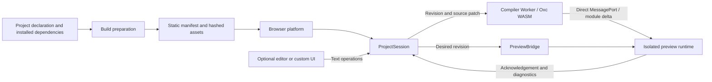

# Architecture

Reploom separates build-time asset preparation, main-thread session state, incremental compilation in a Worker, and isolated preview execution.

## Ownership

| Owner            | Holds                                                                                | Releases                                         |
| ---------------- | ------------------------------------------------------------------------------------ | ------------------------------------------------ |
| Browser platform | Manifest requests, verified asset cache, compiler client and bounded validation queues | `platform.dispose()`                             |
| Project session  | Source revisions, selection, diagnostics, check cancellation and the last working program | `session.dispose()`                              |
| Preview bridge   | An opaque-origin iframe, MessagePorts, acknowledgements and in-flight revision       | `preview.dispose()`                              |
| Compiler Worker  | Oxc WASM instance, source bases, project compilers and bounded transform cache       | Last lease, idle retirement or platform disposal |
| Preview runtime  | Module instances, import slots, framework state and scoped resources            | Module retirement or preview teardown            |
| Editor adapter   | CodeMirror views, per-file text trees, undo history and active syntax graph          | `editor.destroy()`                               |
| Language Worker | Active large-document text, parse fragments and syntax transport identities | File change, idle retirement or editor disposal |

Core components receive explicit service interfaces. `ProjectSession` takes `SessionServices` for loading, compilation, scheduling, ID generation, and optional validation; the compiler coordinator takes an engine loader, reply callback, clock, and task scheduler. `createBrowserPlatform` wires these together for the browser, allowing hosts to override `fetch` and the compiler Worker factory. Each platform owns its services.

Session state is independent of the view layer, so the same session can drive React, plain DOM, or a custom host UI. A new preview runtime requires build bundling, compiler integration, and a runtime adapter.

## Preparation and first preview

During preparation, the build package validates project declarations, resolves installed dependencies into reusable vendor bundles, and compiles initial modules with the same Rust compiler used for browser edits. It writes content-hashed assets and license notices first, then atomically replaces `manifest.json` after all referenced files exist.

The browser platform fetches the manifest, then starts source, program, vendor, bootstrap, and binary-resource requests together. Manifest schema 2 includes the prepared resource index, so resource requests can start without waiting for program JSON. Each asset is verified before use. By default, compiler Worker and WASM downloads begin with the first source change. Hosts may call `session.prepare()` earlier in response to editing intent; the shared preparation task completes after the Worker acknowledges engine readiness, without compiling sources or changing the preview. The prepared Worker bundles its engine loader, avoiding another dynamic module request inside the Worker. Configuration and Worker loading start together; their consumers share the session cancellation scope. The Worker checks its prepared compiler identity, and the loader verifies the WASM bytes before instantiation.

Compiler configuration is copied and deeply frozen when it enters the compiler or browser platform. Dependencies, execution policy, resources, and debug settings therefore remain stable for the lifetime of a prepared project. Source edits and archives cannot change that configuration. Protocol 8, program schema 8, and module ABI 4 identify the matching transport, artifact, and execution contracts; deployments replace prepared assets and runtime packages together.

## Editing

`ProjectSession` coalesces rapid edits and waits for IME composition before requesting compilation. Edit composition walks ordered text pieces once, without reading the unchanged document. The compiler Worker applies every source patch in order to keep its document state current, but replaces superseded pending compile jobs with each project's latest revision.

Admission is an injected timing policy, separate from source revisions and cancellation. An idle first edit enters the next task without a debounce wait. Closely spaced input, pending edits, or active work use a trailing delay of 40–120 ms based on input cadence and measured compile-to-preview-acknowledgement cost. Completing work retains the last input timestamp so a fast compile does not turn a typing burst into repeated immediate jobs. A quiet interval, also bounded to 40–120 ms, starts a new burst. Sustained input caps the requested wait at 240 ms from the first pending edit; browser scheduling and execution add their own latency. An explicit `updateDelayMs` retains a fixed delay. Immediate operations bypass the wait, and composition resets pending admission without publishing incomplete input.

A source-base mismatch asks the client to reseed that project with its complete current source revision. The client retries once, clears that project's delivery base, and leaves other projects and the shared Worker running. Artifact-base mismatches follow the same recovery path. Compile diagnostics remain project-local; an engine failure retires the Worker. Preview generations distinguish a new execution realm from a source revision within an existing realm.

The project compiler reuses both transforms and resolved module artifacts. A changed file set invalidates resolution, so deleting an imported file still fails even when its importer is unchanged. Resolved artifacts are immutable and weakly keyed by their cached transform; cache eviction also releases this optional reuse. Static CSS and asset modules keep their identity across edits. Weighted service-time scheduling gives focused editors a higher weight while continuing background work.

Where JavaScript Promise Integration (JSPI) is available, the Worker can suspend WASM at explicit checkpoints between compiler stages. Other engines yield between modules. Both paths yield to the task queue so cancellation messages can run; the suspended WASM instance remains unavailable for reentry.

Compiled module deltas normally travel directly from the compiler Worker to the preview over a dedicated `MessagePort`, while `ProjectSession` receives a lightweight program reference. React subscribes to selected session fields. `PreviewBridge` permits one in-flight update and retains only the newest desired revision. An acknowledgement establishes the base for later deltas; a missing base triggers a full program synchronization.

Artifacts separate executable module content from a debug table keyed by module path. Delta construction compares execution content independently of maps: a comment or location-only change can update debug information without retransmitting or reevaluating the module. Source revisions still advance, so diagnostics and checks retain their exact source identity even when generated code is unchanged.

Inside the preview, update planning computes reachability and propagation without executing user code. Evaluation stages candidate records, commit publishes them, and notification runs acceptance callbacks after publication. These phases preserve unchanged module identities. Compile errors leave the last working preview intact. Evaluation failures roll back staged changes where possible; a failure after essential resources have been retired can require a fresh preview. Module disposal and dynamic imports share the runtime's cleanup scopes.

## Compiler plan and lowering

Compilation builds one `ModulePlan` from Oxc's semantic state. Its name allocator reserves decoded symbols across scopes and unresolved references before selecting Refresh helpers, then includes the transformed scopes before allocating module, dependency, and slot names. Every derived name receives its own reservation. Unicode escapes and nested bindings therefore follow the same collision rules as ordinary identifiers.

The plan maps semantic symbol IDs to typed dependency/slot references. Each dependency keeps an ordered slot vector for the execution ABI and a name index for registration; both share compile-lifetime name storage. Import reads, checkpoint calls, dynamic imports, and default declarations are constructed directly as AST nodes with their source spans. The linker consumes this plan once, emits the factory prelude, and releases its indexes before code generation. Generated expressions never pass through a second parser.

Code generation produces an unshifted source map. Its JSON writer adds the wrapper's fixed line offset as an unmapped prefix while encoding, preserving token coordinates and concatenated-map state.

## Import bindings and update boundaries

The Rust linker gives each named import a generated local reference to an importer-owned slot, populated by the runtime. Reading an import calls that slot's export reader directly; it does not search the module registry or namespace. A reverse index maps dependency records to their committed named-import subscribers. Commit visits subscribers of changed dependencies and updates their readers; retirement detaches the old importer before its slots become frozen cleanup references. Slot identity and object layout remain stable across updates. Namespace imports retain their namespace object and Proxy behavior.

Staged slots initially reference staged export getters, preserving lexical initialization and cyclic TDZ errors. Retirement leaves an old importer's slots attached to its original exports for cleanup. The linker and runtime share module ABI 4, covered by native ESM differential tests and update/cleanup regressions. Stable data slots keep publication out of property-descriptor reconfiguration.

`import.meta.hot.acceptExports(names)` declares a selective update boundary. The runtime records the names consumed by each static import edge. A dependency still evaluates when its code changes, but its importers can remain in place when every name they consume is accepted. Namespace, dynamic, and explicit side-effect imports propagate conservatively. Withdrawing acceptance expands the update plan before commit. Export equality alone never skips module side effects.

React acceptance compares the previous and next exported values and their component-property descriptors. Compatible components and compound components can form a refresh boundary alongside unchanged primitive exports. Changed export keys, changed primitive values, component-property accessors, or other non-component values propagate to importers. Component-property getters are inspected as descriptors without invoking them. Fast Refresh then decides which component state can survive the accepted update.

## Editor analysis

The editor keeps CodeMirror's text tree, transactions, input handling, history, and viewport rendering. The View owns the active document; the per-file map stores suspended documents and captures scroll coordinates only when switching away. Status-only synchronization avoids DOM measurements and document snapshots. External source changes become incremental transactions on the existing view, preserving its plugins and selection mapping. Switching independent documents or resetting a project replaces the view state.

Documents of at least 64,000 UTF-16 code units use a separate language Worker. It owns incremental text and Lezer parse fragments. A persistent text cursor serves parser chunks and nearby reads without creating a new tree iterator for each line; ordered source patches identify their base revision, and a missing base requests a complete source snapshot. Parsing yields at task boundaries between parser steps and drops superseded analysis. A long token may still occupy one parser step, but does so off the input thread and outside the compiler Worker's queue.

For a large document without reusable fragments, the Worker first parses through the visible range, publishes that prefix, then completes the document using open parse fragments. Coverage travels with the result: the editor can highlight the prefix while full-document syntax remains pending. Both results belong to the same source revision but have distinct delivery versions.

The return channel preserves a shared syntax graph. Worker-local identities name immutable trees and buffers; replies transfer copies of newly created buffers and list added and retired node identities. The producer stages reference-count changes for child edges and roots, committing them only when the client accepts that delivery. It permits one in-flight graph and keeps only the newest pending tree. A rejected delivery leaves the accepted base unchanged, so the next delta can skip obsolete trees entirely. Reused subtrees require no traversal; retirement visits only nodes that lose their last reference. The receiver stages new records, validates their graph, and then applies additions and removals to its existing map. The editor reconstructs those nodes using its configured language node set, retaining highlighting, indentation, and bracket metadata. The client rejects obsolete source revisions before decoding their trees and acknowledges accepted results only after reconstructing them. Source resynchronization resets the graph generation, preventing a late acknowledgement from committing a retired base. This keeps CodeMirror's synchronous syntax consumers usable after analysis arrives without copying the entire tree on every edit. Tree availability remains asynchronous while analysis is pending.

The language Worker bundles only CodeMirror’s upstream `Text` and `ChangeSet` source modules. The pinned sources retain the installed editor version and are hash-checked during the UI build; the host editor continues to use the complete state package. Text crosses the Worker boundary as source patches, never as library instances.

After a result matches the desired revision, the analysis client notifies its editor. The editor checks the active path and document identity, then installs the cached tree with CodeMirror's public parsing API. Completed Worker analysis therefore reaches highlighting without waiting for the background parser's next idle slot. Small-document parsing retains CodeMirror's normal scheduler.

The adapter bundles two narrow Lezer patches. A lazily constructed predecessor index replaces repeated reverse sibling scans in packed tree buffers; its immutable buffer weakly owns the index. The token scanner consumes consecutive code units that follow the same self-transition through a separate string-scan function, preserving grammar, range, and lookahead decisions. Both the host and language Worker use this scanner. The published adapter includes the patched dependency closure, so consumers receive the same behavior without configuring their package manager to apply the workspace patches.

Each editor owns at most one language Worker. File changes and disposal abort pending creation and terminate its Worker; an idle analysis Worker retires after 30 seconds. A late factory completion cannot install into a retired lifetime. The first failure restarts from complete sources; a repeated failure falls back to local parsing and reports through the optional error callback. The active result and per-file CodeMirror histories have their own lifetimes. Editor disposal clears per-file histories and installs an empty state through CodeMirror’s public API before destroying the view, releasing document and syntax payloads even if browser code temporarily retains the retired view. This protocol belongs to the UI adapter and leaves the execution ABI and headless runtime independent of CodeMirror.

## Revision-bound user operations

File transactions validate their complete result before publishing one source revision. Selection follows a moved active file, required entry/style/check files remain present, and the editor drops histories for removed files. A transaction carries all related writes, including import changes supplied by the caller; compilation sees the completed file set.

Archives contain source files, the selected file, a prepared-project identity, and optional explicit state. Restoring one validates it and starts a new preview generation. Modules register portable state with `import.meta.state(key, initial)`. During evaluation, each candidate owns private values, a baseline snapshot, and a read/write set. Before publication, all candidates validate against the committed cells. A changed cell that the candidate read or wrote rejects the complete update. Unobserved cells attach to the latest committed cell, preserving input received while evaluation was suspended.

Cell assignments carry versions; bounded structural comparison also detects nested object and array mutations without installing deep Proxies on user data. Publication validates every candidate before transferring any state, and performs no user callbacks. Surviving cells retain identity, so handlers still running during adapter handoff update the committed state. Failed candidates drop their parent references. If resource disposal requires a fresh realm, the failure carries a bounded snapshot of committed state through the generation-aware recovery path. Compute evaluation failures can seed a replacement Worker from the same snapshot; Stop, watchdog termination, and execution failures keep their reset policy.

These transactions cover registered state and module publication. Arbitrary globals, DOM effects, and framework internals keep their own lifetimes. A conflict is reported to the editor; a subsequent edit or rerun retries explicitly rather than automatically repeating user side effects.

Saving state requires a settled preview and rejects a source revision that changes during capture. Error navigation likewise accepts only locations from the current revision. Debug mappings identify the evaluated module version, including callbacks from an older evaluation, so a stale error cannot silently select an unrelated line in newly edited source.

Optional tests and type checking are injected validation services. Tests receive a snapshot in a separate iframe/Compute Worker. The type checker retains a compiled WASM Module and an indexed, UTF-8 declaration layer during a short Worker lease; each invocation gets a fresh WASM instance and a private project-file overlay. File and directory lookups query these two indexes directly. Diagnostics reuse the checker's UTF-16 line and column coordinates; entries without coordinates share a lazily built line index per source file for that result batch. Projects of at least 128,000 UTF-16 code units enable incremental checking by default, retaining at most 1 MiB of build information during the checker lease. Explicit `compilerOptions.incremental` overrides that policy. The checker validates file signatures and dependencies from this metadata on each invocation. Each platform permits one active job and eight queued jobs of each kind. Source changes cancel their session's old checks; platform disposal cancels all its validation work. Results carry source revisions without participating in preview commits.

## Memory and lifecycle

Verified asset requests have one producer and detachable consumer leases. Cancelling one consumer removes its waiter; the last consumer leaving aborts the request and evicts the pending entry. Session loading, compiler preparation, and checks pass their own signals through this boundary. Cancelling a compiler request stops that revision; the shared compiler remains owned by its project leases. Releasing the last project terminates it, while an otherwise idle compiler follows its retirement timer. Downloads time out after 30 seconds by default, and a late response cannot populate a cancelled cache entry. Failure and timeout allow a new request. Completed assets larger than the cache budget are delivered to their waiting consumers without entering the settled cache or evicting its smaller entries. Concurrent consumers still share that download. A project load also owns a request scope: if one required asset fails, the scope releases its other leases while downloads shared with another project continue.

After successful type checking, the Worker lease lasts five seconds by default. It retains the compiled Module and declaration index, while each check's linear memory becomes collectible with its instance. Cancellation, failure, platform disposal, or an invocation above the configured 128 MiB threshold retires the Worker immediately.

Before a memory-pressure retirement, the Worker returns a checkpoint containing its immutable compiled Module and bounded incremental build information. The client retains this checkpoint for the remaining lease and seeds a fresh Worker on the next changed-source check; a WASM Instance or linear memory never crosses this boundary. Initialization sends the cached Module without fetching or copying the WASM binary again. If Module serialization is unsupported, the client acquires verified WASM bytes on demand under the same cancellation scope and retries initialization.

The client separately retains one exact source/result pair for the same idle period, bounded to 1,000,000 UTF-16 source code units. An unchanged file set reuses copied diagnostics even after memory pressure retires the Worker; a changed file set runs the checker again. Cancellation, failure, disposal, and idle expiry clear both the result and any checkpoint. Idle termination bounds retention even when an engine defers collection. See [integration](integration.md#optional-checks) for lifetime controls.

Within a compile, the parser arena owns syntax nodes and shared name bytes. Semantic analysis reserves its estimated scope, symbol, and reference counts; linking consumes that semantic state and returns only wrapper text and dependency metadata. The linker visitor, plan indexes, and semantic tables are released before code generation and source-map encoding; arena allocations live until the compile returns. `crates/compiler/src/lib.rs` owns the pipeline, `linker/plan.rs` owns names and bindings, `linker.rs` lowers the AST, and `output.rs` owns the result handle crossing WASM.

The Oxc dependency family shares one pinned upstream commit, including the cover-grammar parser, lexer changes, and type-speculation cache. The parser's negative cache is keyed by source offset and grammar context; delimiter lookahead rejects impossible generic candidates before recursive AST construction. Both structures are released with that parse. `parser.rs` selects the same lookahead and type recursion policy for preparation and browser edits. Resource-limit diagnostics survive speculative rewind, including cover-grammar state restoration, and return through normal Rust cleanup so the instance can compile the next edit. The [vendor patches](../vendor/README.md) isolate Reploom's export index and resource policy from the upstream implementation.

After 30 seconds without pending compilation, the compiler Worker terminates and releases its WASM instance and transform caches. Its compiler client may retain one immutable `WebAssembly.Module` for up to five minutes, allowing a new Worker to reuse compiled machine code and reseed project sources. The last session lease ending, platform disposal, or a fatal compiler failure also releases that cached module.

The compiler also reports its WASM linear-memory capacity. Once capacity exceeds the configured threshold, the client replaces the Worker at the next eligible compile: the minimum lifetime must have elapsed, pending compilation must be empty, and delivered artifacts must be acknowledged. Defaults are 64 MiB and 30 seconds. The new Worker receives complete source bases; existing preview realms and their state remain alive. This releases the high-water allocation by ending its owner rather than assuming the WASM allocator can shrink linear memory.

The verified asset cache is limited to 8 MiB and 32 settled entries. Transform caches enforce per-project and shared byte/entry limits. These budgets bound optional retention; active module graphs, framework state, undo history, WASM high-water memory, and browser allocations have separate owners.

Source provenance has a separate owner. A feature probe selects inline factories where source URLs work, or classic Blob scripts where they are needed for useful asynchronous error stacks. Active source URLs remain leased to the preview; optional historical versions are capped at 32 entries and 4 MiB of code/map text. Only one decoded source map is retained. Eviction releases historical URLs, and teardown releases every remaining URL before its disposal acknowledgement. This matters in WebKit, where revoking a script URL immediately after loading was observed to mute later callback errors.

Async completion checks the owner's lifetime before installing a Worker, object URL or preview connection. Disposal aborts owned requests, settles pending callers and closes ports. It does not wait indefinitely for user cleanup.

## Module boundaries

The runtime's public entry points remain `core.ts` and `browser.ts`. Internal files follow their owners:

| Directory | Responsibility |
| --- | --- |
| `project/` | Project declarations and the session state machine, with injected services |
| `browser/` | Platform composition, compiler client lifetime, and preview transport |
| `compiler/` | Worker entry, fair job scheduling, transforms, resolution, and bounded caches |
| `execution/` | Graph planning, evaluation, resource scopes, and execution budgets |
| `execution/adapters/` | React and DOM integration, plus module boundary policy |
| `execution/compute/` | Compute Worker execution, watchdog, and result protocol |
| `shared/` | Wire contracts, source patches, verified assets, ports, and task scheduling |

Verified asset loading lives in `shared/`; the browser platform composes its cache and consumer cancellation scopes. The compiler entry receives its engine loader from the preparation build. The UI package separates `react/` from `codemirror/`; either adapter can be used through its existing package entry point. Import rules prevent project state from acquiring concrete browser or execution services and keep compiler and preview implementations independent.

`execution/module-runtime.ts` keeps import slots, staged evaluation, and cleanup scopes together because commits and rollbacks must preserve their shared invariants. Its update planner is a separate graph operation; staging, commit, and notification remain adjacent procedures inside the runtime's ownership scope. Transport, resource caching, and compiler scheduling have independent lifetimes and separate modules.
